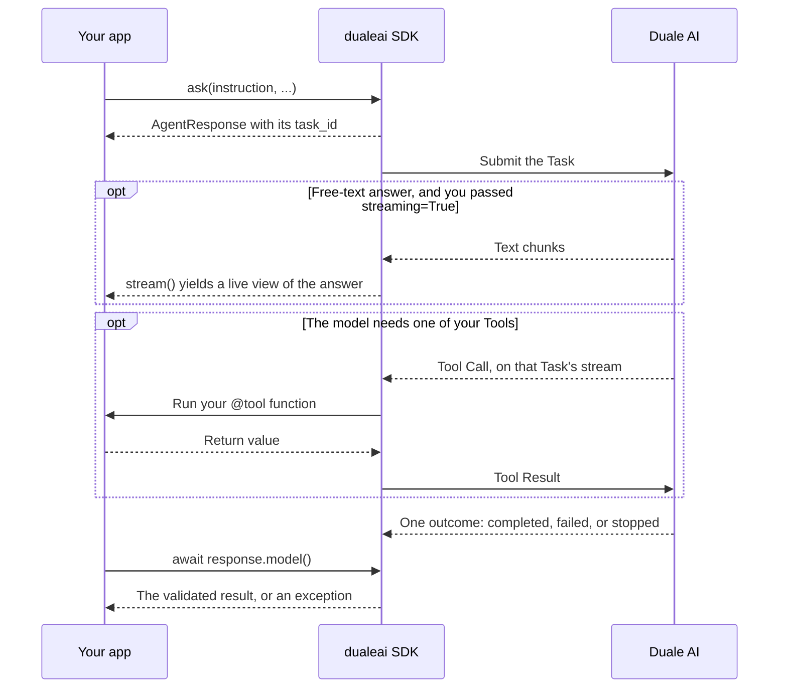

# Duale AI Python SDK

Use `dualeai` to submit Tasks, validate results, and expose Python functions as Tools.
Duale AI runs the Tasks; your async Python application runs its registered Tools.

**Status:** Public preview. Interfaces can change before a stable release.

## Install

Use CPython 3.10 through 3.14 on Linux or macOS:

```bash
python -m pip install dualeai
```

## Run the first live Task

Ask your administrator for a provisioned Tenant, an Agent Identity API token, and a model pool with at least one
configured model.
Set your provisioned token in the current shell:

```bash
export DUALEAI_TOKEN=dualeai_your_provisioned_token_here
```

Save this as `quickstart.py`:

```python
import asyncio

from pydantic import BaseModel

from dualeai import ask, create_sdk


class SupportDecision(BaseModel):
    next_action: str
    reason: str


async def main() -> None:
    async with create_sdk() as sdk:
        response = await ask(
            instruction=(
                "Synthetic support case: A customer asks to reset an account password, "
                "but identity verification has not been completed. Recommend the next "
                "safe step and explain why; do not change the account."
            ),
            res=SupportDecision,
            sdk=sdk,
        )
        print(response.task_id)
        decision = await response.model()
        print(decision.next_action)


asyncio.run(main())
```

Run `python quickstart.py`. A successful run prints the Task ID, then the validated `next_action`; values depend on the model.
`ask()` returns a response handle. `await response.model()` waits until the Task ends and validates its result
against `SupportDecision`.

Before retrying a failure, use [Errors and reliability](https://duale.ai/en/docs/sdk/errors) to identify its cause.

## Configuration

`DUALEAI_TOKEN` is required for live requests.
[SDK configuration](https://duale.ai/en/docs/sdk/configuration#environment-variables) lists every other setting, its
default, and the workflow that needs it. The
[configuration example](https://github.com/dualeai/dualeai-python/blob/main/.env.example) has every setting in one file.

## Integrate into an application



- **Results:** streamed text is a live view; take the result from `await response.model()`. See
  [Stream an answer](https://duale.ai/en/docs/sdk/streaming).
- **Stopping:** `await response.stop(reason)` asks Duale AI to stop the Task; cancelling `response.task` stops only
  your own code. See
  [Observe the Task outcome](https://duale.ai/en/docs/sdk/concepts#observe-the-task-outcome).
- **Tools:** the same Tool Call can arrive more than once, so make each Tool safe to call twice. See
  [Handle delivery and retries](https://duale.ai/en/docs/sdk/tools#handle-delivery-and-retries).
- **Permissions:** [Task actions](https://duale.ai/en/docs/sdk/reference#task-actions) and
  [Library actions](https://duale.ai/en/docs/sdk/reference#library-actions) list the permission each operation needs.
- **Logging:** constructing the SDK replaces your process's root logging handlers. See
  [SDK configuration](https://duale.ai/en/docs/sdk/configuration#logging).

## Examples and next steps

The [examples guide](https://github.com/dualeai/dualeai-python/tree/main/examples) lists setup, permissions, and the
cleanup that document examples need.

For application tests without a live connection, use the
[MockSDK reference](https://duale.ai/en/docs/sdk/reference#mocksdk).

## Project links

- [SDK documentation](https://duale.ai/en/docs/sdk)
- [Release notes](https://github.com/dualeai/dualeai-python/releases)
- [Issues](https://github.com/dualeai/dualeai-python/issues)
- [Contributing](https://github.com/dualeai/dualeai-python/blob/main/CONTRIBUTING.md)
- [Security policy](https://github.com/dualeai/dualeai-python/security/policy) — report suspected vulnerabilities through
  the private routes there, not through a public issue
- [Apache-2.0 license](https://github.com/dualeai/dualeai-python/blob/main/LICENSE)
